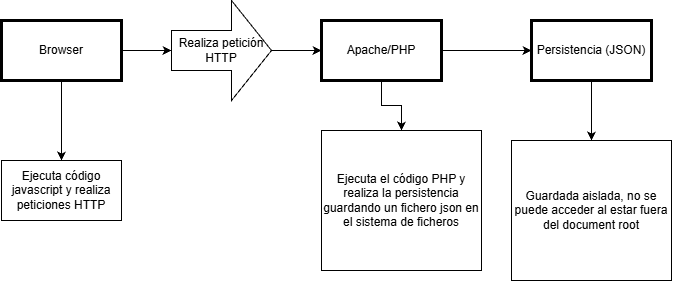

# Punto de recuperación

Añadido un tag al commit de github:  
[acuevasdev github tag](https://github.com/aCuevasDev/Practica-Acumulativa-RA1-2/releases/tag/RA1-con-dockerfile-en-vez-de-mapear-rutas-en-compose)

# Estado de los contenedores:

Desde `C:\Users\AlexCuevasCervilla\Desktop\Desarrollo Entorno Servidor\Practica-Acumulativa-RA1-2\docker`, se ejecutó `docker compose ps`:

| NAME                                        | IMAGE                                | COMMAND                | SERVICE  | CREATED       | STATUS       | PORTS                                       |
| ------------------------------------------- | ------------------------------------ | ---------------------- | -------- | ------------- | ------------ | ------------------------------------------- |
| asociacion-jukebox-multiservicio-mariadb-1  | mariadb:11.1                         | "docker-entrypoint.s…" | mariadb  | 8 seconds ago | Up 7 seconds | 0.0.0.0:3307->3306/tcp, [::]:3307->3306/tcp |
| asociacion-jukebox-multiservicio-postgres-1 | postgres:16.2                        | "docker-entrypoint.s…" | postgres | 8 seconds ago | Up 7 seconds | 0.0.0.0:5432->5432/tcp, [::]:5432->5432/tcp |
| asociacion-jukebox-multiservicio-web-1      | asociacion-jukebox-multiservicio-web | "docker-php-entrypoi…" | web      | 8 seconds ago | Up 8 seconds | 0.0.0.0:8091->80/tcp, [::]:8091->80/tcp     |

# Esquema

## TODO

TODO: Se refiere a que en el informe muestres cómo se protege cada recurso y expliques por qué no se responde igual ante un acceso no autorizado:

Página privada: está pensada para una persona que navega en el sitio. Si no tiene una sesión iniciada, normalmente se la redirige al formulario de inicio de sesión.
API: la consumen JavaScript u otros programas. Si la petición no está autorizada, debe responder con un código HTTP —por ejemplo, 401 o 403— y, normalmente, un mensaje en JSON, no con una página de inicio de sesión.
Un esquema posible sería:

La idea importante es que ambas deben comprobar el acceso, pero usan respuestas distintas porque las páginas y las API son consumidas de manera diferente. En el documento ya aparece un esquema de petición HTTP en 13-preparacion-ajax.md.
